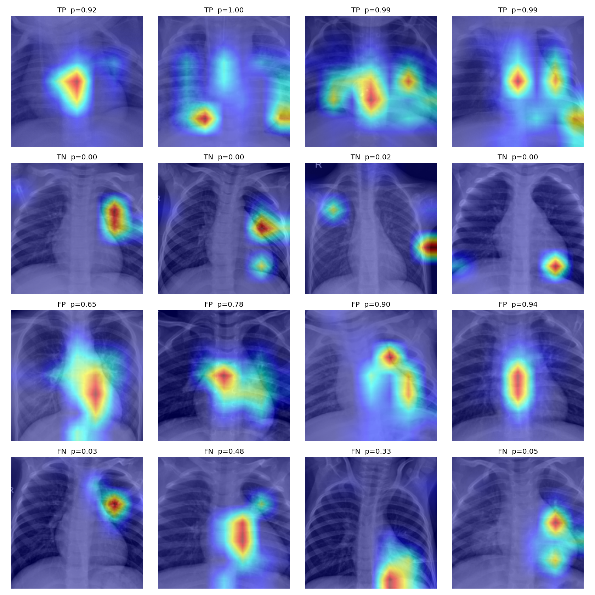

# Pneumonia Chest X-ray Classifier

ResNet50 classifier for pediatric chest X-rays (normal vs pneumonia), evaluated with a
patient-level split, bootstrap confidence intervals and robustness checks.

**[Live demo](https://huggingface.co/spaces/DyyFirm/pneumonia-cxr)** runs fully in your browser (ONNX). A FastAPI + Docker server version is included.

> Research project. Not a medical device and not for diagnosis.

## Results (held-out test set, 940 images)

| Metric | Value | 95% CI |
|---|---|---|
| AUROC | 0.988 | 0.979 – 0.995 |
| Sensitivity | 0.978 | 0.966 – 0.988 |
| Specificity | 0.923 | 0.889 – 0.953 |

Decision threshold 0.516, chosen on the validation set (not the test set).
Confusion matrix (rows = true, columns = predicted): NORMAL [251, 21], PNEUMONIA [15, 653].



## Data and method
- Dataset: Chest X-Ray Images (Pneumonia) from Kermany et al., via Kaggle. Check the license and cite the original source.
- The raw download held 11,712 files, but only 5,824 were unique (duplicate folders), which I removed by file hash.
- Split by **patient ID** (2,789 patients), 70/15/15, so no patient appears in more than one split.
- ImageNet-pretrained ResNet50, class-weighted loss, mild augmentation (no horizontal flip), early stopping on validation AUROC.

## What the checks show
- **Grad-CAM** highlights are often central or at the image edge, so they do not prove the model looks at lung tissue.
- **Occlusion tests:** removing the center barely changes validation AUROC (0.991 to 0.985); removing a thin border changes it little (0.982 at 8 px); the signal is spread across the image.
- **Baselines:** logistic regression on 32×32 raw pixels reaches AUROC 0.966, and global brightness statistics alone reach 0.846. The dataset is relatively easy and may contain non-clinical cues.

## Limitations
- One pediatric hospital, no external validation. May not work on adults or other X-ray machines.
- Many pneumonia images show tubes and devices, which a model could use as shortcuts.
- Not validated clinically.

## Run it
```
docker build -t pneumonia-cxr .
docker run --rm -p 7860:7860 pneumonia-cxr    # open http://localhost:7860/docs
```
`scripts/export_onnx.py` shows how the browser model was exported.

## Repo layout
`app/` API, `model/` weights and metadata, `notebooks/` training and evaluation, `scripts/` ONNX export, `assets/` figures.